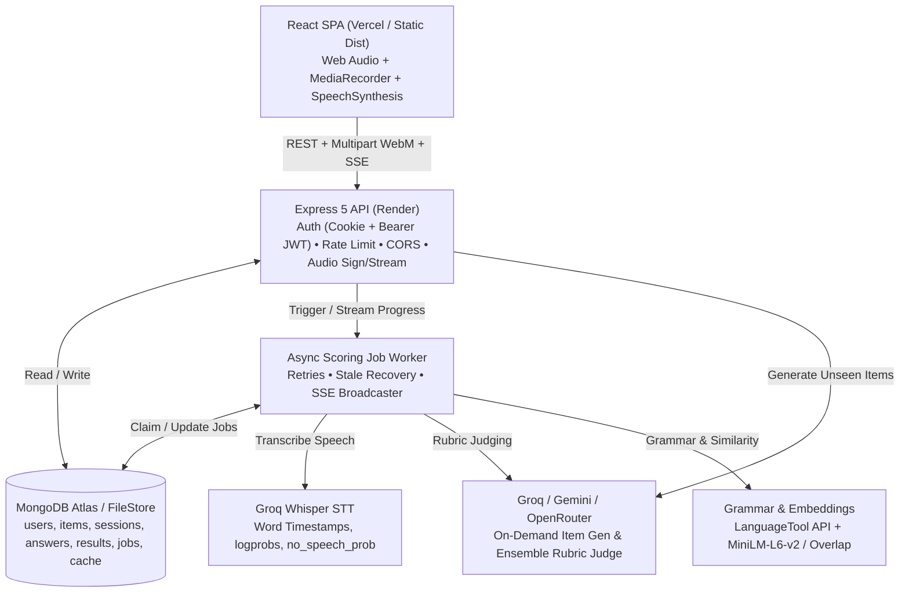

# FluentPath (`Versant-Fluent`)

> **An AI-powered, 10-part English proficiency assessment and practice platform in the style of Pearson Versant — featuring dynamic LLM question generation, custom section-specific tests with exact marks, speech-to-text fluency analytics, Bayesian Rasch ability estimation, and multi-run LLM rubric judging.**

> *Disclaimer: FluentPath provides practice estimates (GSE 10–90, CEFR A1–C2, and approximate Versant 20–80 equivalents). It is an independent educational tool and is not affiliated with or endorsed by Pearson PLC or the Versant brand.*

---

## Live Deployment

- **Frontend (Vercel):** `https://versant-fluent.vercel.app`
- **Backend / Unified Web Service (Render):** `https://versant-fluent.onrender.com`
- **Health Endpoint:** `https://versant-fluent.onrender.com/health`

---

## Table of Contents

1. [What We Built & Key Capabilities](#what-we-built--key-capabilities)
2. [Tech Stack](#tech-stack)
3. [System Architecture](#system-architecture)
4. [Monorepo Structure](#monorepo-structure)
5. [Assessment Format: All 10 Parts (A–J)](#assessment-format-all-10-parts-aj)
6. [Detailed Scoring, Psychometrics & Rubric Engine](#detailed-scoring-psychometrics--rubric-engine)
   - [1. Instant Deterministic Parts (A, C, E, F)](#1-instant-deterministic-parts-a-c-e-f)
   - [2. Spoken Comprehension & Repeat (G, H)](#2-spoken-comprehension--repeat-g-h)
   - [3. AI Rubric-Judged Writing & Speaking (B, D, I, J)](#3-ai-rubric-judged-writing--speaking-b-d-i-j)
   - [4. Speech Metrics & Pronunciation Proxy](#4-speech-metrics--pronunciation-proxy)
   - [5. Grammar & Semantic Similarity Pipelines](#5-grammar--semantic-similarity-pipelines)
   - [6. Bayesian Rasch (EAP), Skill Composites & Marks](#6-bayesian-rasch-eap-skill-composites--marks)
7. [API Reference](#api-reference)
8. [Local Development Setup](#local-development-setup)
9. [Production Deployment (Render + Vercel + Docker)](#production-deployment-render--vercel--docker)

---

## What We Built & Key Capabilities

### 1. Authentic 10-Part Assessment + Custom Section-Specific Builder
- **Full Assessment Mode:** Runs sequentially through all 10 Versant-style parts (`A` through `J`) covering **Reading**, **Writing**, **Listening**, and **Speaking** with strict per-item timers and play-once audio prompts.
- **Custom Section-Specific Test Builder:** From the Practice Hub (`/dashboard`), candidates can select:
  1. Any specific section (**Part A – J**),
  2. Custom **number of questions** (`1–20` via presets or numeric stepper), and
  3. **Difficulty level** (**Easy** `A2–B1`, **Medium** `B1–B2`, **Hard** `B2–C1`),
  and click **GO** to run a targeted mini-exam with **exact marks**, **percentage accuracy**, and **GSE/CEFR estimates**.

### 2. Zero-Repetition Dynamic AI Question Bank
- **134 Curated Seed Items** across Parts A–J (`content/items/*.json`), auto-synchronized on startup.
- **Unseen-First Selection:** Every session inspects both past submitted `answers` **and** past `sessions` for the user so previously encountered items are never recycled unnecessarily.
- **On-Demand Groq LLM Generation:** When unseen items for the requested difficulty level and `questionCount` are insufficient, `createSession()` calls `generatePartItems()` (in chunked batches of up to 5 items) to synthesize brand-new, schema-validated items with full answer keys and rubrics, saves them directly to MongoDB, and serves them immediately.

### 3. Resilient Audio Capture & Play-Once Playback
- **Microphone Check & Live Waveform:** Pre-test microphone recording check with real-time Web Audio `AnalyserNode` amplitude metering.
- **Play-Once Integrity:** Listening items (`E, F, G, H, J`) request HMAC-SHA256 signed, 5-minute expiring URLs via `/api/audio/sign` and play prompts once via pre-generated `.wav`/`.mp3` files or browser Web Speech API synthesis fallback (`window.speechSynthesis`).
- **Reliable MediaRecorder Pipeline:** Captures `audio/webm;codecs=opus` (`16kHz` mono with echo cancellation & noise suppression), flushes final clusters via `requestData()`, prevents double submissions on manual vs auto-stop, and safely handles short/silent recordings.

### 4. Asynchronous Evaluation Worker + Live SSE & Polling
- Instant-scored parts (`A, C, E, F`) finalize immediately on part completion; async parts (`B, D, G, H, I, J`) run through a persistent background job queue (`jobs` collection).
- Supports **Server-Sent Events** (`/api/sessions/:id/events`) paired with immediate and periodic result polling (`api.getResult`), exponential retry backoff (`setTimeout` wakeup), and stale-job recovery (>90s).

### 5. Complete Score Transparency & Progress Tracking
- **Per-Item Breakdown:** Displays full task prompts/stories, candidate typed responses or **Groq Whisper** speech transcripts, word-by-word Levenshtein diff chips (`ok` / `sub` / `del` / `ins`), playable WebM audio recordings, expected/model answers, speech metrics (WPM, pause ratio, long pauses, fluency), and unanswered/timed-out item accountability (`0 / 1 mark`).
- **Analytics & Privacy:** Progress chart over time (`Recharts`), target role cutoff presets (Voice, Non-Voice, IT, Client Consulting, Custom), official score calibration submissions, and one-click GDPR-style personal data deletion (`DELETE /api/me/data`).

---

## Tech Stack

| Layer | Technologies |
| :--- | :--- |
| **Monorepo** | npm Workspaces (`packages/shared`, `apps/api`, `apps/web`), TypeScript 5.7 |
| **Frontend** | React 18, Vite 6, React Router 6, Zustand 5, Tailwind CSS 3, Framer Motion 12, Recharts, Lucide Icons |
| **Backend** | Node.js 20+, Express 5, Zod 4, Helmet, Express Rate Limit, Multer, JWT (`jsonwebtoken`), `bcryptjs` |
| **Database** | MongoDB Atlas (`mongodb` driver) with automatic zero-config JSON FileStore fallback (`data/db.json`) |
| **Speech-to-Text** | Groq Whisper API (`whisper-large-v3-turbo` with word & segment timestamps + confidence logs) |
| **LLM Judging & Generation** | OpenAI-compatible ensemble supporting **Groq** (`openai/gpt-oss-120b`), **Gemini** (`gemini-2.0-flash`), and **OpenRouter** |
| **Grammar & Semantics** | Public **LanguageTool** API (`/v2/check`) + heuristic fallback; `@huggingface/transformers` (`Xenova/all-MiniLM-L6-v2`) + lexical overlap fallback |
| **Deployment** | Render (Docker / Node Web Service), Vercel (Static SPA), MongoDB Atlas (M0) |

---

## System Architecture



### Dual Deployment Capability
- **Unified Single-Service Mode:** `apps/api` automatically detects `apps/web/dist/index.html` at startup, serves the built React SPA as static assets, and routes non-`/api` GET requests to `index.html`.
- **Split Mode (Vercel + Render):** Frontend on Vercel sets `VITE_API_URL` to the Render API origin. Cross-origin authentication works cleanly via both `SameSite=None; Secure` cookies and `Authorization: Bearer <token>` headers stored in `localStorage`.

---

## Monorepo Structure

```text
Versant-Fluent/
├── packages/
│   └── shared/
│       └── src/index.ts              # Zod schemas, PART_META, TIMING, GSE/CEFR helpers, shared TS types
├── apps/
│   ├── api/
│   │   ├── src/
│   │   │   ├── config.ts             # Environment config, model overrides, budgets, paths
│   │   │   ├── index.ts              # Express bootstrap, CORS, trust proxy, static SPA serving, cleanup cron
│   │   │   ├── db/
│   │   │   │   ├── index.ts          # Store initialization & bulk seedItems()
│   │   │   │   ├── mongoStore.ts     # MongoDB adapter + indexes
│   │   │   │   ├── fileStore.ts      # Atomic local JSON store adapter
│   │   │   │   ├── store.ts          # Unified Collection/Store interfaces
│   │   │   │   └── types.ts          # Document interfaces
│   │   │   ├── middleware/auth.ts    # Cookie & Bearer JWT verification + role guards
│   │   │   ├── providers/
│   │   │   │   ├── llm.ts            # Groq -> Gemini -> OpenRouter client + cooldowns + JSON retry
│   │   │   │   ├── stt.ts            # Groq Whisper transcription + silence/hallucination filtering
│   │   │   │   ├── grammar.ts        # LanguageTool v2 + heuristic grammar checker
│   │   │   │   ├── embeddings.ts     # MiniLM-L6-v2 semantic cosine + token containment/overlap
│   │   │   │   └── util.ts           # Timeout fetch, daily provider budgets, concurrency limiters
│   │   │   ├── routes/               # authRoutes, sessionRoutes, audioRoutes, meRoutes, adminRoutes
│   │   │   ├── scoring/
│   │   │   │   ├── index.ts          # Part A–J scoring orchestrator & guardrails
│   │   │   │   ├── objective.ts      # Part A Levenshtein, Part C/F MCQ, Part E dictation, Part H WER
│   │   │   │   ├── judge.ts          # Multi-run LLM ensemble median & disagreement detector
│   │   │   │   ├── prompts.ts        # Rubric dimensions, CEFR descriptors, scoring anchors
│   │   │   │   ├── speech.ts         # WPM, pause ratio, long pauses, fillers, fluency, pronunciation proxy
│   │   │   │   ├── text.ts           # Tokenization, word alignment, English/Latin ratio, verbatim/repetition checks
│   │   │   │   ├── rasch.ts          # Bayesian EAP ability estimator (GSE 10–90) & inverseRasch
│   │   │   │   └── aggregate.ts      # Part marks, skill EAP aggregation, composite GSE/CEFR/Versant
│   │   │   ├── services/
│   │   │   │   ├── itemGeneratorService.ts  # Dynamic Groq item generator for all 10 parts & 3 levels
│   │   │   │   ├── sessionService.ts        # Unseen filtering, chunked generation, session state & timers
│   │   │   │   ├── answerService.ts         # Answer submission, instant grading & job queuing
│   │   │   │   ├── jobWorker.ts             # Async worker, retry timers, stale recovery, SSE broadcast
│   │   │   │   ├── resultService.ts         # Complete review builder including missed/timed-out slots
│   │   │   │   ├── audioService.ts          # HMAC URL signing/verification & retention cleanup
│   │   │   │   └── authService.ts           # User registration, login, guest creation, JWT signing
│   │   │   └── scripts/              # seed.ts, generateItems.ts, goldRegression.ts
│   │   └── test/                     # Vitest unit tests (objective.test.ts, rasch.test.ts)
│   └── web/
│       └── src/
│           ├── pages/                # Landing, Auth, Dashboard (Section Builder), TestRunner, Evaluating, Results, History, Settings
│           ├── components/tasks/     # TaskCard + A–J task UIs (TypeOneWord, Reconstruct, ReadAndChoose, WriteEmail, Dictation, ChooseResponse, ListenAndSpeak, RepeatSentence, SpeakingSituation, StoryRetell)
│           ├── components/common/    # Navbar, PartStepper, TimerRing, WaveformMeter, Button, Badge
│           ├── hooks/                # usePlayOnce, useRecorder, useServerClock
│           ├── store/                # useAuthStore, useTestStore, useUiStore
│           └── lib/                  # api.ts (fetch + Bearer + API_BASE), motion.ts
├── content/
│   ├── items/                        # A.json .. J.json (134 original seed items)
│   └── gold/goldSet.json             # Regression test fixtures
├── scripts/                          # Audio tone fixture generator
├── Dockerfile                        # Node 20 slim container build
├── render.yaml                       # Render blueprint
└── vercel.json                       # Root Vercel workspace build & SPA rewrites
```

---

## Assessment Format: All 10 Parts (A–J)

| Part | Name | Skill | Task Summary | Full Test Count | Default Practice Count | Custom Range | Item Time Limit | Base Seed Bank | Scoring Mode |
| :---: | :--- | :--- | :--- | :---: | :---: | :---: | :---: | :---: | :--- |
| **A** | Sentence Completion | Reading | Type one word for the blank | 10 | 6 | 1–20 | 25 s | 25 | Instant (Objective) |
| **B** | Passage Reconstruction | Writing | Read 30s, rewrite from memory in 90s | 3 | 2 | 1–20 | 120 s | 10 | Async (Hybrid + LLM Judge) |
| **C** | Reading Comprehension | Reading | Read passage & answer 2 MCQs | 3 | 2 | 1–20 | 180 s | 8 | Instant (Objective) |
| **D** | Email Writing | Writing | Write a 100+ word email covering 3 points | 2 | 1 | 1–20 | 540 s | 5 | Async (Hybrid + LLM Judge) |
| **E** | Dictation | Listening | Listen once, type exact sentence | 8 | 5 | 1–20 | 35 s | 18 | Instant (Objective) |
| **F** | Response Selection | Listening | Listen once, pick A / B / C | 8 | 5 | 1–20 | 20 s | 18 | Instant (Objective) |
| **G** | Passage Comprehension | Listening | Hear story, answer 3 spoken questions | 2 stories (6 Qs) | 1 story (3 Qs) | 1–20 stories | 110 s | 10 | Async (STT + Similarity) |
| **H** | Repeat | Speaking | Hear sentence once, repeat aloud | 10 | 6 | 1–20 | 30 s | 24 | Async (STT + WER + Fluency) |
| **I** | Speaking Situations | Speaking | 10s prep, 60s spoken response | 2 | 1 | 1–20 | 80 s | 8 | Async (STT + LLM Judge + Fluency) |
| **J** | Story Retelling | Speaking | Hear story, retell in 30s | 3 | 2 | 1–20 | 75 s | 8 | Async (STT + Coverage + LLM Judge) |

---

## Detailed Scoring, Psychometrics & Rubric Engine

FluentPath combines deterministic linguistics, acoustic/whisper fluency analytics, semantic embeddings, multi-run LLM rubric judging, and Bayesian Item Response Theory (Rasch).

### 1. Instant Deterministic Parts (A, C, E, F)

- **Part A — Sentence Completion (`scoreSentenceCompletion`):**
  - Exact normalized match against `accepted[]` → **`1.0`**.
  - Single-word typo (`length >= 4` and character Levenshtein distance `=== 1`) → **`0.5`** (half credit).
  - Multiple words or non-matching word → **`0.0`**.
  - Enters Rasch model at item difficulty `b = item.gse`.
- **Part C — Reading Comprehension (`scoreChoice`):**
  - Each MCQ earns `1` if `choice === answer`, else `0`.
  - Item score = mean across passage questions; each question enters Rasch individually with guessing floor **`guess = 0.25`** (`questionGse`).
- **Part E — Dictation (`scoreDictation`):**
  - Word alignment via Levenshtein (`alignWords`):
    $$\text{wordScore} = \max\left(0,\; 1 - \frac{\text{editDistance}}{\max(1, |\text{refWords}|)}\right)$$
  - Punctuation (`[.,?!;:]`) Levenshtein accuracy (`markScore`) and capitalization accuracy (`capScore`) combine into `punctScore = 0.5 * markScore + 0.5 * capScore`.
  - Final item score:
    $$\text{score}_E = 0.85 \cdot \text{wordScore} + 0.15 \cdot \text{punctScore} \cdot \text{wordScore}$$
- **Part F — Response Selection:**
  - Exact match against `answerKey.answer ?? answerKey.correct` → `1` or `0`, entering Rasch with **`guess = 0.33`**.

---

### 2. Spoken Comprehension & Repeat (G, H)

All spoken parts (`G, H, I, J`) first pass through **Groq Whisper** (`whisper-large-v3-turbo`, `temperature: 0`, `language: "en"`):
- Recordings `< 1200` bytes or unparseable empty WebM frames are safely treated as silence (`noSpeechProb = 1.0`).
- Common Whisper silence hallucinations (`"thank you"`, `"you"`, `"thanks"`, `"thank you for watching"`) with `noSpeechProb > 0.3` or `<= 2` words are automatically stripped to `""`.
- **Speech Guardrails (`speechGuard`):** Responses with fewer than `minWords` (`3` for I/J, `min(3, targetLen)` for H), `noSpeechProb > 0.6`, `latinRatio < 0.7`, or `englishRatio < 0.12` (when `>= 6` tokens) receive `0` with `no_speech` or `non_english` flags.

- **Part G — Passage Comprehension (`scoreListenAnswer`):**
  - Requires `>= 1` spoken word and `noSpeechProb <= 0.6`.
  - For each acceptable reference `e` in `expected[sub]`, computes `max(containment(e, transcript), bestSimilarity(e, [transcript]))`.
  - Tiered credit against mode thresholds (`local` embeddings vs `overlap` fallback):
    - `best >= th.gHigh` → **`1.0`**
    - `best >= th.gMid` → **`0.5`**
    - otherwise → **`0.0`**
- **Part H — Repeat Sentence (`scoreRepeat`):**
  - Word alignment (`sub: 1, del: 1, ins: 0.5`):
    $$\text{accuracy} = \max\left(0,\; 1 - \frac{\text{distance}}{\max(1, |\text{refWords}|)}\right)$$
  - Final score blends accuracy and speech fluency:
    $$\text{score}_H = 0.80 \cdot \text{accuracy} + 0.20 \cdot \text{fluency}$$

---

### 3. AI Rubric-Judged Writing & Speaking (B, D, I, J)

#### Multi-Run LLM Ensemble (`judge.ts` & `prompts.ts`)
- Candidate text is wrapped inside `<response>...</response>` tags with prompt-injection protections and leak-marker checks (`LEAK_MARKERS`).
- **Ensemble Plan:**
  - When **2+ LLM providers** are active: runs `JUDGE_RUNS` (default `2`) evaluations on each of the first 2 providers.
  - When **1 LLM provider** is active (e.g., Groq only): runs **3 independent calls** and takes the **median** of each rubric dimension and **median GSE**.
  - If GSE disagreement across runs exceeds **8 points** (`disagreement > 8`) and a 3rd provider exists, runs a tie-breaker and flags `judges_disagree`.
  - Confident results (`>= 2` grades) are cached by SHA-256 `(part, itemId, sub, normalizedResponse, SCORING_VERSION)`.
  - If all LLM providers are unavailable or rate-limited, scoring gracefully degrades to rule-based **provisional scoring** (`provisional: true`).

#### Rubric Dimensions (`0–5` per dimension) & Exact Score Formulas

Let $\text{rubric01} = \frac{\sum \text{dims}}{5 \cdot |\text{dims}|} \in [0, 1]$.

- **Part B — Passage Reconstruction**
  - *Dimensions:* `content`, `accuracy`, `grammar`, `vocabulary`
  - *Deterministic baseline:*
    $$\text{det}_B = 0.50 \cdot \text{ideaCoverage} + 0.30 \cdot \text{passageSimilarity} + 0.20 \cdot \text{grammarScore}$$
  - *With Judge:*
    $$\text{score}_B = 0.50 \cdot \text{det}_B + 0.50 \cdot \text{rubric01}, \quad \text{gse} = \text{judgeGSE} + \text{clip}((\text{det}_B - 0.6)\cdot 10,\; -4,\; 4)$$
  - *Integrity Caps:* If pasted (`integrity.pasted && verbatimRatio > 0.6`) → capped at **`0.2`** (`copied_source`); if `repetitionRatio > 0.4` → capped at **`0.2`** (`repetitive`).

- **Part D — Email Writing**
  - *Dimensions:* `task_fulfillment`, `organization`, `grammar`, `vocabulary`, `tone`
  - *With Judge:* starts at `rubric01` and `judgeGSE`.
  - *Provisional (no judge):*
    $$\text{score}_D = 0.35 \cdot \text{themeCov} + 0.20 \cdot \min\left(1, \frac{\text{wc}}{\text{minWords}}\right) + 0.25 \cdot \text{grammarScore} + 0.10 \cdot \frac{\text{greeting} + \text{closing}}{2} + 0.10 \cdot \min(1, 1.6 \cdot \text{lexicalDiversity})$$
  - *Adjustments & Caps:*
    - `wc < minWords` → `-0.05` score (`-2` GSE)
    - Missing greeting or closing → `-0.03` score (`-1` GSE)
    - `wc < 60` → capped at **`0.4`** (`too_short`)
    - Off-topic (`!judge.onTopic || themeCov === 0`) → capped at **`0.3`** (`off_topic`)
    - `repetitionRatio > 0.4` → capped at **`0.2`** (`repetitive`)

- **Part I — Speaking Situations**
  - *Dimensions:* `task_appropriateness`, `completeness`, `language_accuracy`, `coherence`
  - *With Judge:*
    $$\text{score}_I = 0.60 \cdot \text{rubric01} + 0.40 \cdot \text{fluency}, \quad \text{gse} = \text{judgeGSE} + \text{speakingAdjust}$$
  - *Caps:* Off-topic (`!judge.onTopic`) → capped at **`0.3`**; `repetitionRatio > 0.4` → capped at **`0.2`**.

- **Part J — Story Retelling**
  - *Dimensions:* `content_coverage`, `accuracy`, `language`, `coherence`
  - *Element Coverage:* semantic/containment matching across all `answerKey.elements`.
  - *With Judge:*
    $$\text{score}_J = 0.35 \cdot \text{coverage} + 0.35 \cdot \text{rubric01} + 0.30 \cdot \text{fluency}, \quad \text{gse} = \text{judgeGSE} + \text{speakingAdjust}$$
  - *Caps:* Off-topic → capped at **`0.3`**; `repetitionRatio > 0.4` → capped at **`0.2`**.

---

### 4. Speech Metrics & Pronunciation Proxy

Computed from Whisper word timestamps (`speech.ts`):
- **Speech Rate (`wpm`):** Content words per minute over active speech span (`ws[last].end - ws[0].start`).
- **Articulation Rate (`articulationWpm`):** Content words per minute excluding pauses `> 0.4s`.
- **Pause Ratio & Long Pauses:** Cumulative gaps `> 0.4s` divided by total span; `longPauses` counts gaps `> 1.0s`.
- **Fillers & Restarts:** Tracks `"um", "uh", "er", "erm", "ah", "hmm"`, hesitant `"like"`, and immediate word/phrase restarts.
- **Fluency Score (`0..1`):**
  $$\text{fluency} = \text{clip}\Big(1 - \text{pacePenalty} - 1.2\cdot\max(0, \text{pauseRatio} - 0.2) - \min(0.3, 0.06\cdot\text{longPauses}) - \min(0.2, 0.02\cdot\text{fillersPer100})\Big)$$
  where `pacePenalty` deducts `(100 - wpm) / 200` if `wpm < 100` or `(wpm - 170) / 200` if `wpm > 170`.
- **Pronunciation Proxy (`0..1`):** Derived from Whisper segment `exp(avgLogprob)` mapped over `[0.50, 0.95]`, contributing low-weight adjustment in `speakingAdjust`:
  $$\text{speakingAdjust} = \text{clip}\big((\text{fluency} - 0.7)\cdot 10,\; -5,\; 5\big) + \text{clip}\big((\text{pronunciation} - 0.7)\cdot 6,\; -2,\; 2\big)$$

---

### 5. Grammar & Semantic Similarity Pipelines

- **Grammar (`grammar.ts`):** Queries **LanguageTool** (`/v2/check`, filtering noise rules like whitespace/typography) and falls back to regex heuristics when unreachable:
  $$\text{grammarScore} = \text{clip}(1 - 0.1 \cdot \text{errorsPer100},\; 0,\; 1)$$
- **Similarity (`embeddings.ts`):**
  - `EMBEDDINGS=local`: Runs **`Xenova/all-MiniLM-L6-v2`** (`q8`) via `@huggingface/transformers`, taking `max(cosine, 0.9 * containment)`.
  - `EMBEDDINGS=overlap`: Lightweight zero-memory lexical token containment / F1 overlap (recommended for 512 MB cloud tiers).

---

### 6. Bayesian Rasch (EAP), Skill Composites & Marks

- **EAP Ability Estimate (`rasch.ts`):**
  Evaluates the posterior over the discrete GSE grid $t \in [10, 90]$ (step `0.5`, `SCALE = 10`, prior $\mathcal{N}(48, 16^2)$):
  - Objective items contribute Rasch log-likelihoods using $p(t) = \text{guess} + (1 - \text{guess}) \cdot \frac{1}{1 + e^{-(t - b)/10}}$.
  - Judged items contribute Gaussian log-likelihoods $-\frac{1}{2}\left(\frac{t - \text{gse}_i}{\text{sd}_i}\right)^2$.
  - Produces per-skill `gse`, posterior `sd`, and uncertainty interval `halfWidth = max(minRangeHalfWidth, clamp(1.28 * sd, 3, 10))` combined in quadrature with judge disagreement.
- **Overall Composite GSE (`aggregate.ts`):**
  Weighted mean across active skills (`reading: 20%`, `writing: 25%`, `listening: 20%`, `speaking: 35%`). For section-specific tests, only the tested skill is active, so overall GSE matches that tested skill directly.
- **CEFR & Versant Mapping:**
  - CEFR bands: `<22` Below A1, `22–29` A1, `30–42` A2, `43–58` B1, `59–75` B2, `76–84` C1, `85–90` C2.
  - Versant equivalent: $\text{round}(\text{clip}(20 + (\text{GSE} - 10) \times 0.75,\; 20,\; 80))$.
- **Exact Marks (`aggregate.ts` & `resultService.ts`):**
  Calculated across **all assigned question slots** (`1` mark per item for A–F/H–J; `questions.length` marks per passage for G), so unanswered or timed-out items count as `0` marks and appear in the detailed review with model answers.

---

## API Reference

| Group | Method & Path | Description |
| :--- | :--- | :--- |
| **Auth** | `POST /api/auth/register` | Create email/password account (`bcrypt`, returns user + JWT) |
| | `POST /api/auth/login` | Sign in with email/password |
| | `POST /api/auth/guest` | Instant guest user creation (`14d` JWT) |
| | `POST /api/auth/logout` | Clear auth cookie |
| | `GET /api/auth/me` | Current user profile from cookie or Bearer JWT |
| **Sessions** | `POST /api/sessions` | Create full or custom section test (`{ mode, part?, level?, questionCount? }`) |
| | `GET /api/sessions/:id` | Fetch current session state, public items, answered keys, deadlines |
| | `POST /api/sessions/:id/timer` | Record server-side item start timestamp |
| | `POST /api/sessions/:id/answers` | Submit JSON text/MCQ answer or multipart `.webm` audio |
| | `POST /api/sessions/:id/advance` | Advance to next part or finalize session |
| | `POST /api/sessions/:id/submit` | Force-submit session & trigger worker |
| | `GET /api/sessions/:id/events` | SSE live grading progress stream |
| | `GET /api/sessions/:id/result` | Detailed results, marks, skill GSE, speech metrics, transcripts & model answers |
| **Audio** | `GET /api/audio/sign` | Generate 5-min HMAC-signed playback URL + `promptText` |
| | `GET /api/audio/stream` | Enforce play-once check & stream pre-generated WAV or fallback JSON |
| | `GET /api/audio/answer/:answerId` | Stream user's recorded `.webm` answer for result review |
| **User** | `GET /api/me/history` | Last 50 test sessions with GSE, CEFR, marks & level |
| | `GET /api/me/progress` | Overall timeline, target cutoff gap & skill averages |
| | `PATCH /api/me` | Update display name, target role preset & target GSE |
| | `POST /api/me/official` | Log official test score for calibration |
| | `DELETE /api/me/data` | Permanently delete all answers, sessions, results & calibration records |
| **Admin** | `GET /api/admin/health` | Check active LLM providers, STT, grammar & daily budgets (admin role) |
| | `GET / POST / PATCH /api/admin/items` | Manage live item bank |
| | `POST /api/admin/items/generate` | Generate AI items via admin endpoint |
| **Health** | `GET /health` | Lightweight uptime / keep-alive check (`200 OK`) |

---

## Local Development Setup

### Prerequisites
- **Node.js `>= 20.11`**
- A free **Groq API Key** ([console.groq.com](https://console.groq.com)) for Whisper STT, LLM rubric judging, and on-demand question generation.
- Optional: **MongoDB Atlas** connection string (if omitted, automatically uses local JSON FileStore at `data/db.json`).

### Installation & Run

```bash
# 1. Clone repository
git clone https://github.com/BhanuNama/Versant-Fluent.git
cd Versant-Fluent

# 2. Install workspace dependencies
npm install

# 3. Create .env from template and add your GROQ_API_KEY
cp .env.example .env

# 4. Seed all 134 base items (optional; API also auto-seeds on startup)
npm run seed

# 5. Start API (:8787) and Web (:5173) concurrently
npm run dev
```

### Useful Workspace Commands

```bash
npm run typecheck         # Type-check both @fluentpath/api and @fluentpath/web
npm run test              # Run Vitest unit suite (objective & Rasch tests)
npm run build             # Build production frontend bundle to apps/web/dist
npm run start             # Start API server (serves apps/web/dist automatically if built)
npm run seed              # Force-upsert content/items/*.json into active store
npm run generate-items -w @fluentpath/api -- --part=D --count=3 --level=medium
```

---

## Production Deployment (Render + Vercel + Docker)

### Environment Variables

Set these in Render (or Docker) — **never commit real `.env` secrets to Git**:

| Variable | Recommended Value (Render) | Purpose |
| :--- | :--- | :--- |
| `NODE_ENV` | `production` | Enables production security & CORS checks |
| `MONGODB_URI` | `mongodb+srv://...` | MongoDB Atlas cluster URI (allow `0.0.0.0/0` in Network Access) |
| `JWT_SECRET` | `32+ char random string` | Signs auth JWTs and HMAC audio URLs |
| `GROQ_API_KEY` | `gsk_...` | Enables Whisper STT, LLM judging & dynamic item generation |
| `GROQ_LLM_MODEL` | `openai/gpt-oss-120b` | LLM model on Groq |
| `GROQ_WHISPER_MODEL` | `whisper-large-v3-turbo` | Speech-to-text model on Groq |
| `EMBEDDINGS` | `overlap` *(512MB RAM)* / `local` *(1GB+ RAM)* | Similarity backend |
| `CLIENT_ORIGIN` | `https://versant-fluent.vercel.app` | Exact Vercel origin (same-origin Render host is auto-allowed) |
| `COOKIE_SAMESITE` | `none` *(split)* / `lax` *(same-origin)* | Cross-site cookie support |
| `COOKIE_SECURE` | `true` | Required over HTTPS |

### Render (Backend / Unified Service)
- Uses [`render.yaml`](render.yaml) or [`Dockerfile`](Dockerfile).
- Leave **Root Directory** blank (`.`) so workspace dependencies resolve.
- **Health Check / Keep-Alive Cron URL:** `GET https://versant-fluent.onrender.com/health` every 10–14 minutes.

### Vercel (Frontend CDN)
- Uses root [`vercel.json`](vercel.json) (`npm run build` -> `apps/web/dist` with SPA rewrites).
- Leave **Root Directory** as `./` and set **Application Preset** to **Vite** (or **Other**).
- Add Environment Variable **`VITE_API_URL`** = `https://versant-fluent.onrender.com` (no trailing slash).
